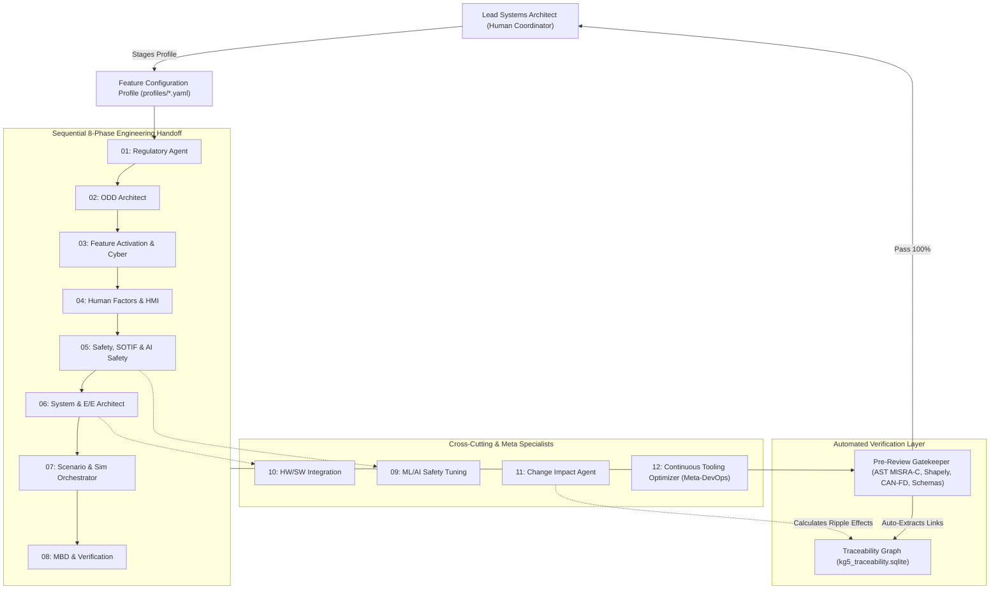

# ADAS/AD Feature Engineering Agentic Workflow: Step-by-Step User Guidelines

**Document Version:** 2.0.0  
**Target Audience:** Lead ADAS/AD Systems Architects, Safety Managers, and Autonomy Tooling Engineers  
**Scope:** Feature-Agnostic Workflow for SAE Level 2 through Level 4 Features  

---

## 1. Quick Orientation: The Human-in-the-Loop Hub-and-Spoke Model



### The 4 Core Rules:
1. **Never Run Unmonitored Autonomous Chains:** You invoke agents sequentially; each output must pass automated gatekeeper checks before you review and sign off.
2. **Strict Bit-for-Bit Determinism:** All reasoning is pinned to local Knowledge Graphs (KG0–KG5), zero LLM temperature, fixed seeds, and SHA-256 context hashing.
3. **Feature-Agnostic Operation:** The engine (agents, schemas, linters) never changes; to build a new feature, you simply stage a new `feature_profile.yaml`.
4. **Strictly Follow Canonical Terminology:** All specifications, interfaces, and state machines must strictly adhere to [kg0_canonical_terminology.json](file:///C:/Users/jayad/.gemini/antigravity/scratch/adas_ad_agentic_framework/knowledge_graphs/kg0_canonical_terminology.json) to eliminate conflicts between ISO 26262 (Functional Safety), ISO 21448 (SOTIF), ISO/SAE 21434 (Cybersecurity), and SAE J3016 (DDT/ODD).

---

## 2. Pre-Flight Setup: Staging Your Feature

Every feature development workspace is isolated in `projects/<feature_id>/` (e.g. `projects/FEAT-L3-HWY-CHAUFFEUR/` or `projects/FEAT-L4-AVP/`), which contains its own `feature_profile.yaml`, `deliverables/`, `.checkpoints/`, and `traceability.sqlite`.

You can select or stage a feature profile:
```bash
# Example: To develop an L3 Highway Chauffeur
cp profiles/l3_highway_chauffeur.yaml profiles/feature_profile.yaml

# Example: To develop an L4 Automated Valet Parking
cp profiles/l4_automated_valet_parking.yaml profiles/feature_profile.yaml

# Example: To develop an L2+ Highway Assist
cp profiles/l2_plus_highway_assist.yaml profiles/feature_profile.yaml
```

Verify profile syntax against the formal schema:
```bash
python -c "import yaml, json, jsonschema; jsonschema.validate(yaml.safe_load(open('profiles/feature_profile.yaml')), json.load(open('schemas/feature_profile.schema.json'))); print('Profile Valid!')"
```

---

## 3. The Happy Path: Step-by-Step Agent Execution & Handoffs

Follow this sequential workflow. Each step specifies **what you provide**, **which agent to invoke**, **what it produces**, and **how to verify it**.

| Step | Agent to Invoke | Required Inputs (What You Provide) | Generated Deliverables (Outputs) | Automated Gatekeeper Linter Check |
| :--- | :--- | :--- | :--- | :--- |
| **1** | **`AGENT_01_REGULATORY`** | `profiles/feature_profile.yaml`<br>`knowledge_graphs/kg1_regulatory.json` | `artifacts/01_compliance_matrix.csv`<br>`artifacts/01_legal_brief.md` | Verifies `REQ-REG-XXX` Trace IDs, ensures UN R157/R171/R155/R156 and EU AI Act coverage. |
| **2** | **`AGENT_02_ODD_ARCHITECT`** | `artifacts/01_compliance_matrix.csv`<br>`profiles/feature_profile.yaml` | `artifacts/02_lane_centering_odd.yaml` (ASAM OpenODD 1.0) | **Shapely Engine:** Validates 2D spatial polygon, confirms centripetal acceleration envelope ($a \le 3.0\text{ m/s}^2$), and lead time $\ge 10.0\text{ s}$. |
| **3** | **`AGENT_03_FEATURE_ACTIVATION`** | `artifacts/02_lane_centering_odd.yaml`<br>`knowledge_graphs/kg1_regulatory.json` | `artifacts/03_subscription_ota.puml`<br>`artifacts/03_tara_threat_analysis.csv` | Enforces **Graceful Session Lock** (no mid-drive cutoff), $\ge 24\text{ h}$ tunnel lease cache, and UN R156 RXSWIN checks. |
| **4** | **`AGENT_04_HUMAN_FACTORS_HMI`** | `artifacts/01_compliance_matrix.csv`<br>`artifacts/02_lane_centering_odd.yaml` | `artifacts/04_hmi_state_matrix.csv`<br>`artifacts/04_hmi_wireframes.md` | **Formal State Verifier:** Proves zero non-terminal dead ends, reachability from `OFF`, positive TOR timeouts, and mandatory MRM fallback. |
| **5** | **`AGENT_05_SAFETY_SOTIF_AI`** | `artifacts/02_lane_centering_odd.yaml`<br>`artifacts/04_hmi_state_matrix.csv` | `artifacts/05_safety_analysis.csv`<br>`artifacts/05_safety_goals_spec.md` | Checks HARA ASIL classifications, FTTI $\le 20\text{ ms}$ for steering, SOTIF quantitative triggers, and ISO/PAS 8800 AI failure modes. |
| **6** | **`AGENT_06_SYSTEM_EE_ARCH`** | `artifacts/05_safety_analysis.csv`<br>`artifacts/05_safety_goals_spec.md` | `artifacts/06_vehicle_arch_icd.json`<br>`artifacts/06_system_architecture.md` | **CAN-FD & TSN Protocol Linter:** Calculates ISO 11898-1:2015 frame overhead, bit-stuffing factor, AUTOSAR E2E CRC, and WCET latency $\le 45\text{ ms}$. |
| **7** | **`AGENT_07_SCENARIO_SIM_ORCH`** | `artifacts/02_lane_centering_odd.yaml`<br>`artifacts/05_safety_analysis.csv` | `artifacts/07_scenarios/*.xosc`<br>`artifacts/07_simulation_plan.md` | **`scenariogeneration` & Kinematics:** Synthesizes schema-valid OpenSCENARIO 1.2 XML, checks required braking deceleration $\le 6.0\text{ m/s}^2$ and TTC bounds. |
| **8** | **`AGENT_08_MBD_VERIFICATION`** | `artifacts/06_vehicle_arch_icd.json`<br>`artifacts/07_scenarios/*.xosc` | `artifacts/08_lane_controller.c`<br>`artifacts/08_validation_report.md` | **Tree-Sitter-C AST Parser:** Enforces MISRA-C (zero dynamic memory, zero goto, zero recursion cycles, bounded loops, AUTOSAR E2E checks). |

---

## 4. Execution Commands (Terminal Cheatsheet)

### Mode A: Full StateGraph Pipeline (Durable Checkpoints & Breakpoints)
```powershell
# Run complete V-Model pipeline (Phases 1-8) for a project:
python orchestrator/pipeline_runner.py --project FEAT-L3-HWY-CHAUFFEUR run-pipeline --start-phase 1 --end-phase 8

# Run with interactive step-by-step confirmation prompts:
python orchestrator/pipeline_runner.py --project FEAT-L3-HWY-CHAUFFEUR run-pipeline --step

# Run with an automated breakpoint after a specific agent:
python orchestrator/pipeline_runner.py --project FEAT-L3-HWY-CHAUFFEUR run-pipeline --pause-after AGENT_04_HUMAN_FACTORS_HMI

# Resume execution from any saved checkpoint:
python orchestrator/pipeline_runner.py --project FEAT-L3-HWY-CHAUFFEUR resume --checkpoint projects/FEAT-L3-HWY-CHAUFFEUR/.checkpoints/checkpoint_FEAT-L3-HWY-CHAUFFEUR_phase4_AGENT_04_HUMAN_FACTORS_HMI_BREAKPOINT.json
```
*(Pressing `Ctrl+C` at any time safely interrupts execution, commits an emergency `.interrupted_checkpoint.json`, and halts cleanly without corrupting files).*

### Mode B: Single Agent Execution (With Autonomous Self-Correction)
```powershell
# Example: Run Phase 2 (ODD Architect) within project workspace
python core/agent_executor.py AGENT_02_ODD_ARCHITECT FEAT-L3-HWY-CHAUFFEUR

# Example: Run Phase 4 (Human Factors & HMI)
python core/agent_executor.py AGENT_04_HUMAN_FACTORS_HMI FEAT-L3-HWY-CHAUFFEUR

# Example: Run Phase 8 (MISRA-C Controller Code & Verification)
python core/agent_executor.py AGENT_08_MBD_VERIFICATION FEAT-L3-HWY-CHAUFFEUR
```
*If a drafted artifact has an error (e.g. curve radius too sharp for speed, or an unreachable state), the agent's internal PDCA cycle automatically reinjects the linter diagnostics and repairs the artifact before presenting it.*

### Mode C: Meta-Learning & Tooling Optimization (Agent 12)
```powershell
# Scan execution telemetry, gatekeeper failures, and architect comments to generate CRIP proposals:
python orchestrator/pipeline_runner.py --project FEAT-L3-HWY-CHAUFFEUR optimize-tooling
```
*Agent 12 produces human-reviewable Change Request & Improvement Proposals (CRIP) in `docs/improvement_proposals/` alongside Git patch diffs, strictly validated against regression tests.*

### Mode D: Review Cockpit & Audit Sign-Off
Launch the terminal cockpit dashboard:
```powershell
python orchestrator/cockpit_cli.py status --feature-id FEAT-L3-HWY-CHAUFFEUR
```

Inspect an agent's cryptographic bundle, input/output SHA-256 hashes, and gatekeeper assertions:
```powershell
python orchestrator/cockpit_cli.py inspect --agent-id AGENT_04_HUMAN_FACTORS_HMI --feature-id FEAT-L3-HWY-CHAUFFEUR
```

Approve and seal the execution bundle with your Lead Architect sign-off:
```powershell
python orchestrator/cockpit_cli.py signoff --agent-id AGENT_04_HUMAN_FACTORS_HMI --feature-id FEAT-L3-HWY-CHAUFFEUR
```

Launch the **unified Chainlit cockpit** (chat + pipeline status + approve + tool traces — replaces the former Streamlit dashboard):
```powershell
python -m chainlit run orchestrator/chat_app.py --port 8000
```
Open `http://localhost:8000` in your browser. From there you can type commands (`status`, `run AGENT_01_REGULATORY`, `approve`, `resume`) or chat naturally with the LLM — no separate terminal needed for monitoring.

### Mode E: Synchronize Traceability & Run Change Impact Analysis
Synchronize `traceability.sqlite` across all phases:
```powershell
python skills/trace_extractor.py
```
*This automatically extracts all `REQ-*`, `ODD-*`, `HMI-*`, `SAF-*`, `ARCH-*`, and `CODE-*` identifiers and maps relational links without manual SQL editing.*

Trigger ripple effect analysis when a requirement changes:
```powershell
python orchestrator/pipeline_runner.py --project FEAT-L3-HWY-CHAUFFEUR trigger-change --trace-id ODD-SPEC-001 --reason "Lowered minimum visibility from 150m to 120m for heavy rain"
```

---

## 5. Handling Changes & Regression (The Ripple Effect Loop)

In automotive systems engineering, changes happen continuously (e.g., simulation reveals an unhandled sun-glare angle, or customer demands higher highway speed limits).

### How to Handle a Change Request (CR):
When an upstream parameter changes (e.g. modifying `ODD-SPEC-001`):

1. **Trigger Change Impact Analysis:**
   ```powershell
   python orchestrator/pipeline_runner.py trigger-change --trace-id ODD-SPEC-001 --reason "Lowered minimum visibility from 150m to 120m for heavy rain"
   ```
2. **Review the Generated Impact Report:**  
   Open `artifacts/11_change_impact_report.md`. It automatically lists every affected downstream artifact and marks them as **`STALE`** in `kg5_traceability.sqlite`.
3. **Execute the Prescribed Sequence:**  
   Follow the remediation order listed in the report (e.g. re-run Agent 04 $\to$ Agent 05 $\to$ Agent 07 $\to$ Agent 08).
4. **Re-verify:**  
   The Gatekeeper unblocks the feature only when all dependent artifacts pass 100% and are re-signed.

---

## 6. How to Switch Features (Feature-Agnostic Switch)

To switch the entire ecosystem from **Level 3 Highway Chauffeur** to **Level 4 Automated Valet Parking (AVP)**:

1. **Copy the Profile:**
   ```powershell
   cp profiles/l4_automated_valet_parking.yaml profiles/feature_profile.yaml
   ```
2. **Execute Agent 02 (OpenODD):**
   ```powershell
   python core/agent_executor.py AGENT_02_ODD_ARCHITECT FEAT-L4-AVP
   ```
3. **Execute Agent 04 (HMI Driverless State Machine):**
   ```powershell
   python core/agent_executor.py AGENT_04_HUMAN_FACTORS_HMI FEAT-L4-AVP
   ```
4. **Check Cockpit Status:**
   ```powershell
   python orchestrator/cockpit_cli.py status --feature-id FEAT-L4-AVP
   ```
*Zero framework code changes are needed.*

---

## 7. Quality & Verification Health Check

Run the comprehensive 16-test framework integration suite at any time:
```powershell
python tests/test_framework.py
```
*Expected Result:* `Ran 16 tests ... OK (100% Pass Rate)`.
