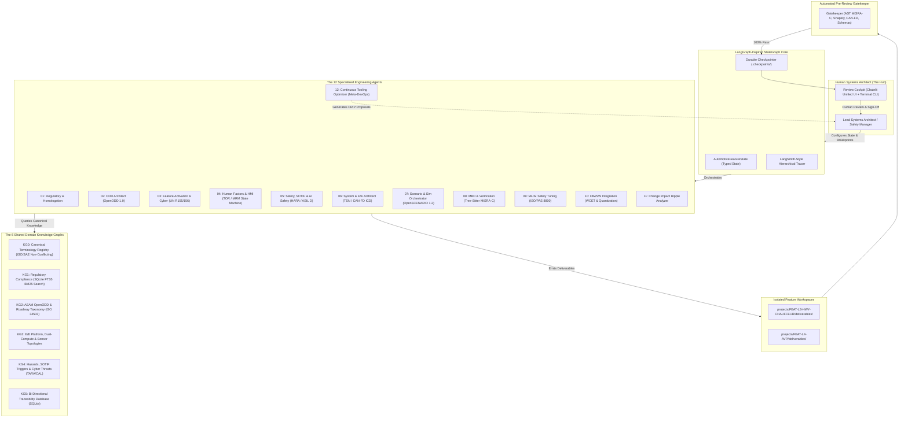

# Autonomous Driving & ADAS Feature Engineering Agentic Ecosystem

[-brightgreen.svg)](#verification--test-suite)
[](#key-capabilities--architectural-pillars)
[](#the-6-shared-domain-knowledge-graphs)
[](#pillar-2-langgraph-durable-statemachine--interruption-engine)

A deterministic, production-grade multi-agent engineering platform designed for architecting, verifying, validating, and homologating safety-critical **Advanced Driver Assistance Systems (ADAS)** and **Autonomous Driving (AD)** features across **SAE Level 2 through Level 4**.

---

## ⚡ Quickstart in 60 Seconds (From VS Code Terminal)

### 1. Configure Your LLM Provider (Local Ollama Auto-Detected)
The framework natively auto-detects and defaults to your local Ollama models (`gemma4:12b`, `qwen3-vl:latest`, `gemma4:latest`) with **zero configuration required**.

If you wish to switch models or use a cloud provider with an API key:
- **In the UI:** Click `[🤖 Switch / Set LLM]` or type `model qwen3-vl:latest` or `model gpt-4o <endpoint> <api-key>`. The application will **remember and persist** your choice across all future restarts in `config/llm_active_config.json`.
- **Via environment:** Copy `cp .env.example .env` and specify `LLM_MODEL`, `LLM_BASE_URL`, or `LLM_API_KEY`.
- **Offline / CI/CD:** If Ollama is not running and no API key is set, the system automatically runs in **Deterministic Offline Simulation Mode**.

### 2. Run System Preparedness Check
Verify your dependencies, knowledge graphs, and LLM endpoint before starting:
```powershell
python orchestrator/doctor.py
```
*(You should see `[READY] System is 100% prepared.`)*

### 3. Spin Up the Unified Mission Control Cockpit
```powershell
python -m chainlit run orchestrator/chat_app.py --port 8000
```
Open **`http://localhost:8000`** in your browser. From here, you have full mission control:
- **Switch or Initialize Projects:** Click `[✨ New Feature Project]` or `use FEAT-L4-AVP`.
- **Run Pipelines & Gates:** Click `[🚀 Launch Full Pipeline]` or execute single agents like `run AGENT_01_REGULATORY`.
- **Human Sign-Off:** Review gatekeeper assertions and approve execution bundles with a single click `[✅ Sign-off]`.
- **Live Regulatory Intelligence:** Ask about UN R157 amendments or ISO 26262 requirements directly in the chat!

---

## Key Capabilities & Architectural Pillars

### 1. Workspace Partitioning & Toolchain Immutability Guard
- **Segregated Feature Workspaces (`projects/<feature_id>/`):** Real engineering deliverables are completely isolated in dedicated feature project workspaces (e.g. `projects/FEAT-L3-HWY-CHAUFFEUR/` and `projects/FEAT-L4-AVP/`), each containing its own `deliverables/`, `.determinism/execution_bundles/`, `.checkpoints/`, and `traceability.sqlite`.
- **Toolchain Immutability Defense:** The core engine (`agents/`, `skills/`, `schemas/`, `knowledge_graphs/`, `core/`, `validators/`) is cryptographically sealed as a read-only toolchain under **ISO 26262-8 Clause 11 (Tool Qualification)** and **ASPICE SUP.8**. Any attempt by an LLM or tool to mutate core framework setup files raises a `ToolchainImmutabilityViolationError`.

### 2. LangGraph-Inspired Durable StateGraph & Breakpoints
- **Durable Checkpointing (`core/state_graph.py`):** Every V-Model phase execution commits a serialized state snapshot to disk. If a phase fails or requires human adjustment, the pipeline rewinds or resumes without burning tokens or re-running upstream certified phases.
- **Human-in-the-Loop Interruption:**
  - **Interactive Step Mode (`--step`):** Prompts for human confirmation before each node transition.
  - **Deterministic Breakpoints (`--pause-after <AGENT_ID>`):** Automatically pauses after designated milestones for off-line expert review.
  - **Graceful Interrupt Handling:** Traps `Ctrl+C` (SIGINT), commits an emergency `.interrupted_checkpoint.json`, and halts cleanly without file corruption.
  - **Hierarchical Traces (LangSmith Concepts):** Nested execution spans tracking timestamps, latencies, gatekeeper verdicts, and human feedback.

### 3. Agent 12: Continuous Tooling Optimizer (Offline Meta-Learning)
- **ASPICE SUP.1 Compliant Improvement:** Scans execution telemetry, gatekeeper failures, and human review rejection notes to synthesize **Change Request & Improvement Proposals (CRIP)** in `docs/improvement_proposals/` alongside unified Git patch diffs.
- **Zero Production Mutation:** Self-modifying code in production is prohibited; all proposed prompt, schema, or linter improvements are pre-validated against the 20-test regression harness before human sign-off.

### 4. Strict Bit-for-Bit Determinism
- Enforces `temperature=0.0`, fixed random seeds (`424242`), content-addressable SHA-256 context hashing, sandboxed VCR tool recording/replaying, and deterministic OpenSCENARIO timestamps.

### 5. Compiler-Grade Verification & Bi-Directional Traceability
- **Real Automotive Linters:** MISRA-C AST parsing via `tree-sitter-c`, ASAM OpenSCENARIO 1.2 XML generation via `scenariogeneration`, centripetal curve acceleration physics via `shapely`, and ISO 11898-1 CAN-FD bit-stuffing overhead calculations.
- **Bi-Directional Relational Graph:** Embedded SQLite database (`traceability.sqlite`) linking `REQ-*` $\to$ `ODD-*` $\to$ `AUTH-*` $\to$ `HMI-*` $\to$ `SAF-*` $\to$ `ARCH-*` $\to$ `SCEN-*` $\to$ `CODE-*` $\to$ `VAL-*`.

---

## System Architecture



---

## The 12 Specialized Engineering Agents

| Agent ID | Role / Specialization | Phase / Scope | Primary Artifact Deliverable |
| :--- | :--- | :--- | :--- |
| **`AGENT_01_REGULATORY`** | Homologation & Type-Approval Lead | Phase 1: Legal Baseline | `01_compliance_matrix.csv`, `01_legal_brief.md` |
| **`AGENT_02_ODD_ARCHITECT`** | Operational Design Domain Systems Lead | Phase 2: ODD Formalization | `02_lane_centering_odd.yaml` (ASAM OpenODD 1.0) |
| **`AGENT_03_FEATURE_ACTIVATION`** | Connected Services & Cyber Architect | Phase 3: Entitlement & TARA | `03_subscription_ota.puml`, `03_tara_threat_analysis.csv` |
| **`AGENT_04_HUMAN_FACTORS_HMI`** | Cognitive Safety & Ergonomics Lead | Phase 4: HMI & Driver Monitoring | `04_hmi_state_matrix.csv`, `04_hmi_wireframes.md` |
| **`AGENT_05_SAFETY_SOTIF_AI`** | Unified Safety Architect (ISO 26262/21448) | Phase 5: Functional & SOTIF Safety | `05_safety_analysis.csv`, `05_safety_goals_spec.md` |
| **`AGENT_06_SYSTEM_EE_ARCH`** | Distributed E/E & Network Architect | Phase 6: E/E Platform & ICD | `06_vehicle_arch_icd.json`, `06_system_architecture.md` |
| **`AGENT_07_SCENARIO_SIM_ORCH`** | Virtual Verification & Kinematics Lead | Phase 7: Scenario Generation | `07_scenarios/*.xosc` (ASAM OpenSCENARIO 1.2) |
| **`AGENT_08_MBD_VERIFICATION`** | Embedded Code & Telemetry Lead | Phase 8: MBD & MISRA-C AST | `08_lane_controller.c`, `08_validation_report.md` |
| **`AGENT_09_ML_AI_TUNING`** | Perception ML & AI Safety Lead | Cross-Cutting: ISO/PAS 8800 | `09_ml_training_manifest.yaml`, `09_iso8800_data_audit.md` |
| **`AGENT_10_HW_SW_INTEGRATION`** | SoC Resource & WCET Engineer | Cross-Cutting: Compute Allocation | `10_soc_resource_allocation.json`, `10_wcet_latency_report.md` |
| **`AGENT_11_CHANGE_IMPACT`** | Configuration Management & Governance | Cross-Cutting: Ripple Analysis | `11_change_impact_report.md`, `11_stale_artifacts.json` |
| **`AGENT_12_CONTINUOUS_IMPROVEMENT`**| Agentic DevOps & Tooling Optimizer | Meta-Phase: ASPICE SUP.1 QA | `docs/improvement_proposals/CRIP-*.md`, `.patch` |

---

## The 6 Shared Domain Knowledge Graphs

| Knowledge Graph | Format | Technical Scope & Regulatory Alignment | File Location |
| :--- | :--- | :--- | :--- |
| **KG0: Canonical Terminology** | JSON | Authoritative non-conflicting ADAS/AD definitions (DDT, ODD, OEDR, Transition Demand, MRM, MRC, Safe State, Fail-Operational, Technical Supervisor). | [kg0_canonical_terminology.json](file:///C:/Users/jayad/.gemini/antigravity/scratch/adas_ad_agentic_framework/knowledge_graphs/kg0_canonical_terminology.json) |
| **KG1: Regulatory Compliance** | SQLite FTS5 | UN R157 (ALKS), UN R171 (DCAS), UN R155 (CSMS), UN R156 (SUMS), ISO 26262:2018, ISO 21448:2022, ISO/SAE 21434, ISO/PAS 8800, UL 4600, EU AI Act indexed with BM25 rank search. | [kg1_regulatory.json](file:///C:/Users/jayad/.gemini/antigravity/scratch/adas_ad_agentic_framework/knowledge_graphs/kg1_regulatory.json) |
| **KG2: ODD & Roadway Taxonomy** | JSON | ISO 34503:2023, BSI PAS 1883, and ASAM OpenODD 1.0 scenery (friction $\mu$, curve radius), weather envelopes, lighting, traffic agents, and geofences. | [kg2_odd_taxonomy.json](file:///C:/Users/jayad/.gemini/antigravity/scratch/adas_ad_agentic_framework/knowledge_graphs/kg2_odd_taxonomy.json) |
| **KG3: Vehicle Platform & E/E** | JSON | Fail-operational dual compute (NVIDIA DRIVE Thor + Infineon AURIX TC4x lockstep), Hardware Security Modules (HSM), dual-winding EPS, 2-box IBC braking, TSN/CAN-FD, DSSAD. | [kg3_vehicle_platform.json](file:///C:/Users/jayad/.gemini/antigravity/scratch/adas_ad_agentic_framework/knowledge_graphs/kg3_vehicle_platform.json) |
| **KG4: Hazards, SOTIF & Cyber** | JSON | Unified catalog of ISO 26262 malfunctions (HARA S3/E4/C3), ISO 21448 triggering conditions, ISO/SAE 21434 cyber threats (CAL 1-4), and ISO/PAS 8800 AI weaknesses. | [kg4_hazard_sotif_catalog.json](file:///C:/Users/jayad/.gemini/antigravity/scratch/adas_ad_agentic_framework/knowledge_graphs/kg4_hazard_sotif_catalog.json) |
| **KG5: Traceability Database** | SQLite | Relational dependency database linking requirements across all 8 phases. Powers automated ripple effect analysis. | [kg5_traceability.sqlite](file:///C:/Users/jayad/.gemini/antigravity/scratch/adas_ad_agentic_framework/knowledge_graphs/kg5_traceability.sqlite) |

---

## CLI Execution Cheatsheet

### Mode A: Full StateGraph Pipeline (Durable Checkpoints & Breakpoints)
```powershell
# 1. Run complete V-Model pipeline (Phases 1-8) for a feature project:
python orchestrator/pipeline_runner.py --project FEAT-L3-HWY-CHAUFFEUR run-pipeline --start-phase 1 --end-phase 8

# 2. Run with interactive step-by-step confirmation prompts:
python orchestrator/pipeline_runner.py --project FEAT-L3-HWY-CHAUFFEUR run-pipeline --step

# 3. Run with an automated breakpoint after a specific agent (e.g. ODD or Safety Concept):
python orchestrator/pipeline_runner.py --project FEAT-L3-HWY-CHAUFFEUR run-pipeline --pause-after AGENT_02_ODD_ARCHITECT

# 4. Resume execution from any saved checkpoint:
python orchestrator/pipeline_runner.py --project FEAT-L3-HWY-CHAUFFEUR resume --checkpoint projects/FEAT-L3-HWY-CHAUFFEUR/.checkpoints/checkpoint_FEAT-L3-HWY-CHAUFFEUR_phase2_AGENT_02_ODD_ARCHITECT_BREAKPOINT.json
```
*(Pressing `Ctrl+C` at any time safely traps execution, commits an emergency `.interrupted_checkpoint.json`, and halts cleanly without corrupting files).*

### Mode B: Single Agent Execution (Autonomous Self-Correction Loop)
```powershell
# Run a specific agent phase within project workspace:
python core/agent_executor.py AGENT_02_ODD_ARCHITECT FEAT-L3-HWY-CHAUFFEUR
python core/agent_executor.py AGENT_04_HUMAN_FACTORS_HMI FEAT-L3-HWY-CHAUFFEUR
python core/agent_executor.py AGENT_08_MBD_VERIFICATION FEAT-L3-HWY-CHAUFFEUR
```
*If a drafted artifact violates a schema, MISRA-C rule, or kinematic physics, the internal Plan-Do-Check-Act (PDCA) loop reinjects linter diagnostics to self-correct the artifact before presentation.*

### Mode C: Continuous Tooling Optimization & Meta-DevOps (Agent 12)
```powershell
# Scan execution telemetry, gatekeeper failures, and architect feedback to synthesize CRIP proposals:
python orchestrator/pipeline_runner.py --project FEAT-L3-HWY-CHAUFFEUR optimize-tooling
```
*Agent 12 generates human-reviewable Change Request & Improvement Proposals (CRIP) in `docs/improvement_proposals/` alongside Git patch diffs, strictly validated against the test harness.*

### Mode D: Human Review Cockpits & Audit Sign-Off
```powershell
# Launch the rich terminal review cockpit:
python orchestrator/cockpit_cli.py status --feature-id FEAT-L3-HWY-CHAUFFEUR

# Inspect an agent's cryptographic bundle, input/output SHA-256 hashes, and gatekeeper assertions:
python orchestrator/cockpit_cli.py inspect --agent-id AGENT_04_HUMAN_FACTORS_HMI --feature-id FEAT-L3-HWY-CHAUFFEUR

# Approve and seal an execution bundle with Lead Architect sign-off:
python orchestrator/cockpit_cli.py signoff --agent-id AGENT_04_HUMAN_FACTORS_HMI --feature-id FEAT-L3-HWY-CHAUFFEUR

# Launch the unified Chainlit cockpit (chat + status + approve + tool traces):
python -m chainlit run orchestrator/chat_app.py --port 8000
```

### Mode E: Traceability & Change Impact Analysis
```powershell
# Synchronize all nodes and edges into the relational traceability graph:
python skills/trace_extractor.py

# Trigger bi-directional ripple impact analysis when a requirement shifts:
python orchestrator/pipeline_runner.py --project FEAT-L3-HWY-CHAUFFEUR trigger-change --trace-id ODD-SPEC-001 --reason "Lowered minimum visibility limit to 120m"
```

---

## Verification & Test Suite

The platform includes a 25-test automated verification suite covering schemas, AST parsing, kinematics, bus timing, gatekeepers, state checkpointing, immutability guards, LLM provider resolution, tool registry dispatch, and skeptical regulatory web intelligence:

```powershell
python tests/test_framework.py
```
```text
.........................
----------------------------------------------------------------------
Ran 25 tests in 2.333s

OK (100% Pass)
```

---

## Documentation Navigation

- **[GUIDELINES_TO_USE.md](file:///C:/Users/jayad/.gemini/antigravity/scratch/adas_ad_agentic_framework/GUIDELINES_TO_USE.md)**: Master step-by-step user manual, happy-path handoffs table, and stage-by-stage instructions.
- **[docs/adas_ad_agentic_ecosystem_architecture.md](file:///C:/Users/jayad/.gemini/antigravity/scratch/adas_ad_agentic_framework/docs/adas_ad_agentic_ecosystem_architecture.md)**: Complete system design, domain models, and formal mathematical specifications.
- **[docs/future_work_simulation_and_neural_world_models.md](file:///C:/Users/jayad/.gemini/antigravity/scratch/adas_ad_agentic_framework/docs/future_work_simulation_and_neural_world_models.md)**: Integration roadmap for live CARLA 0.9.15, headless esmini, and NVIDIA Cosmos NIM APIs.
- **[docs/improvement_proposals/](file:///C:/Users/jayad/.gemini/antigravity/scratch/adas_ad_agentic_framework/docs/improvement_proposals/)**: Catalog of Change Request & Improvement Proposals (CRIP) synthesized by Agent 12.
