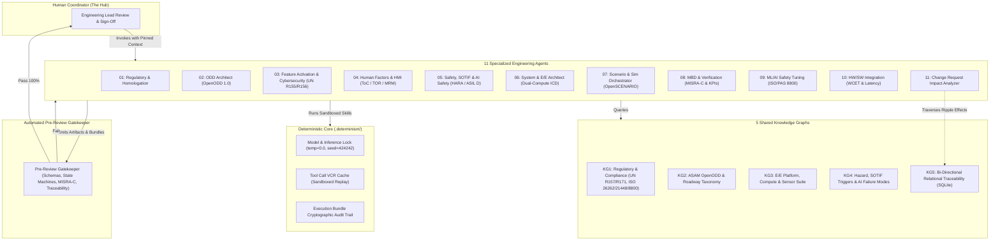

# Autonomous Driving & ADAS Feature Engineering Agentic Framework

A deterministic, multi-agent engineering platform for designing, verifying, and validating safety-critical Advanced Driver Assistance Systems (ADAS) and Autonomous Driving (AD) features from SAE Level 2 through Level 4.

## Key Capabilities & Pillars
- **Feature-Agnostic Core:** Governs L2+ Hands-Off/Eyes-On (UN R171 DCAS), L3 Highway Chauffeur (UN R157 ALKS), and L4 Automated Valet Parking / Shuttles (German StVG / AFGBV) via declarative configuration profiles.
- **Human-in-the-Loop Hub-and-Spoke Governance:** Eliminates autonomous agent runaway. Agents produce verifiable, version-controlled diffs gated by automated linters before human sign-off.
- **Strict Bit-for-Bit Determinism:** Zero LLM temperature, pinned model checkpoints, fixed RNG seeds, content-addressable SHA-256 context hashing, and sandboxed VCR tool recording/replaying.
- **Bi-Directional Relational Traceability:** Embedded SQLite graph (`kg5_traceability.sqlite`) linking regulations $\to$ ODD $\to$ HMI $\to$ Safety Goals (ASIL/FTTI) $\to$ E/E ICD $\to$ Scenarios $\to$ Code $\to$ Test KPIs.
- **Pre-Review Gatekeeper Linters:** Zero agent output reaches human review unless JSON/YAML/XSD schemas, MISRA-C rules, and state machine completeness pass 100%.

## Architecture Overview


## Quick Start & Usage
### 1. Run Framework Verification Suite
```powershell
python tests/test_framework.py
```

### 2. List Registered Agents
```powershell
python orchestrator/pipeline_runner.py list-agents
```

### 3. Execute an Agent Phase (e.g. HMI Design)
```powershell
python orchestrator/pipeline_runner.py run-agent --agent-id AGENT_04_HUMAN_FACTORS_HMI --feature-id FEAT-L3-HWY-CHAUFFEUR
```

### 4. Human Coordinator Cryptographic Sign-Off
```powershell
python orchestrator/pipeline_runner.py signoff --agent-id AGENT_04_HUMAN_FACTORS_HMI --feature-id FEAT-L3-HWY-CHAUFFEUR
```

### 5. Trigger Change Request Ripple Analysis
```powershell
python orchestrator/pipeline_runner.py trigger-change --trace-id ODD-SPEC-001 --reason "Lowered minimum visibility threshold to 120m"
```
