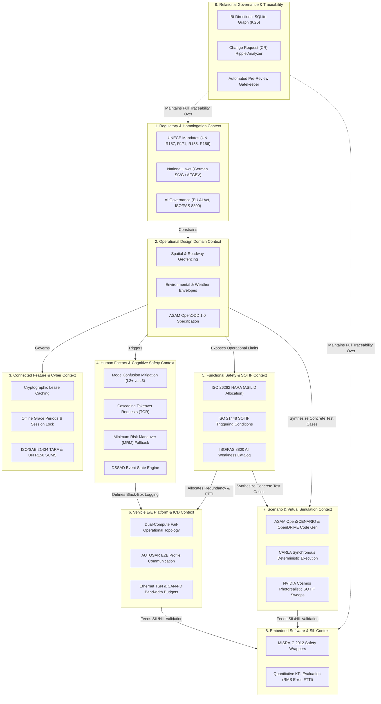
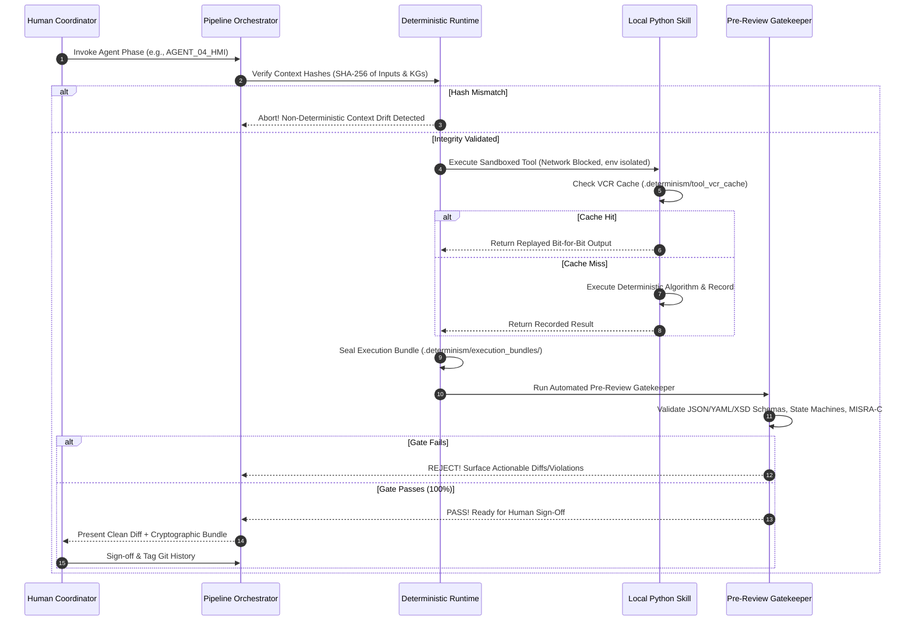
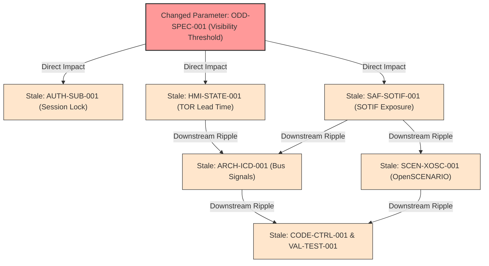

# ADAS & Autonomous Driving (AD) Feature Engineering Agentic Ecosystem
**Architectural Specification & Operational System Model (SAE Level 2 through Level 4)**

---

## 1. Persona Declaration & Operational Mandate

> [!NOTE]
> **Adopted Persona:** **Chief ADAS/AD Systems Architect & Agentic Autonomy Tooling Lead**  
> **Technical Scope:** 15+ years of systems engineering leadership spanning ASPICE Level 3, ISO 26262 (ASIL D), ISO 21448 (SOTIF), ISO/PAS 8800 (AI Safety), ISO/SAE 21434 (Cybersecurity), UNECE Regulations (UN R157, UN R171, UN R155/156), German Autonomous Driving Framework (StVG § 1a–1f / AFGBV), AUTOSAR Classic/Adaptive, and deterministic compiler-grade multi-agent orchestration.

### Operational Philosophy: Human-in-the-Loop Hub-and-Spoke Governance
Safety-critical automotive systems cannot tolerate unpredictable autonomous agent-to-agent chaining or black-box hallucination. This ecosystem enforces a strict **Hub-and-Spoke** governance model:
1. The **Lead Systems Architect (Human)** sits at the center (the Hub) as the sole authorizing entity.
2. Specialized engineering agents (the Spokes) are invoked sequentially with immutable, cryptographic context snapshots.
3. Every agent deliverable is gated by automated, deterministic static linters (the Gatekeeper) and sealed with a cryptographic **Execution Bundle** before reaching the human review queue.
4. The framework is strictly **feature-agnostic**: whether designing an SAE Level 2 Adaptive Cruise Control (ACC), an SAE Level 2+ Highway Assist (DCAS), an SAE Level 3 Highway Chauffeur (ALKS), or an SAE Level 4 Automated Valet Parking (AVP) shuttle, the core engine, schemas, validators, and agents remain identical.

---

## 2. Context Map & Domain Boundaries (Strategic DDD)

The ADAS/AD engineering ecosystem is organized into nine well-defined **Bounded Contexts** that communicate through version-controlled nascent text artifacts (.yaml, .csv, .json, .puml, .xosc, .c):



---

## 3. The 6 Shared Domain Knowledge Graphs & Terminology Registry

Rather than letting agents perform non-deterministic live web searches, the framework couples all reasoning to six local, git-tracked, version-controlled knowledge graphs:

| Knowledge Graph | Format | Technical Scope & Regulatory Alignment | File Location |
| :--- | :--- | :--- | :--- |
| **KG0: Canonical Terminology Registry** | JSON | Authoritative non-conflicting ADAS/AD definitions resolving DDT, ODD, OEDR, Transition Demand, MRM, MRC, Functional Safety Hazards, SOTIF Triggers, Cybersecurity Threats, AI Weaknesses, and Technical Supervisor. | [kg0_canonical_terminology.json](file:///C:/Users/jayad/.gemini/antigravity/scratch/adas_ad_agentic_framework/knowledge_graphs/kg0_canonical_terminology.json) |
| **KG1: Regulatory & Compliance** | JSON / SQLite FTS5 | UN R157 (ALKS), UN R171 (DCAS), UN R155 (CSMS), UN R156 (SUMS), ISO 26262:2018, ISO 21448:2022, ISO/SAE 21434:2021, ISO/PAS 8800:2024, ISO 34501/34502/34503, UL 4600:2023, SAE J3016:2021, German StVG/AFGBV, EU AI Act (2024/1689). | [kg1_regulatory.json](file:///C:/Users/jayad/.gemini/antigravity/scratch/adas_ad_agentic_framework/knowledge_graphs/kg1_regulatory.json) |
| **KG2: ODD & Roadway Taxonomy** | JSON | ISO 34503:2023, BSI PAS 1883:2020, and ASAM OpenODD 1.0 road scenery (lanes, friction $\mu$, curve radius), environmental envelopes (rain, spray, sun glare lux), dynamic traffic, connectivity, and geofence exclusions. | [kg2_odd_taxonomy.json](file:///C:/Users/jayad/.gemini/antigravity/scratch/adas_ad_agentic_framework/knowledge_graphs/kg2_odd_taxonomy.json) |
| **KG3: Vehicle Platform & E/E Topology** | JSON | Fail-operational dual compute (NVIDIA DRIVE Thor + Infineon AURIX TC4x lockstep), Hardware Security Modules (HSM), dual-winding EPS steering, 2-box IBC braking, IEEE 802.1Qbv/CB TSN, CAN-FD SecOC, crash-hardened DSSAD. | [kg3_vehicle_platform.json](file:///C:/Users/jayad/.gemini/antigravity/scratch/adas_ad_agentic_framework/knowledge_graphs/kg3_vehicle_platform.json) |
| **KG4: Hazards, SOTIF & Cyber Threat Catalog** | JSON | Comprehensive catalog of systemic malfunctions (ISO 26262 HARA), environmental triggering conditions (ISO 21448 SOTIF), cybersecurity threats & TARA goals (ISO/SAE 21434), and AI epistemic failure modes (ISO/PAS 8800 / EU AI Act). | [kg4_hazard_sotif_catalog.json](file:///C:/Users/jayad/.gemini/antigravity/scratch/adas_ad_agentic_framework/knowledge_graphs/kg4_hazard_sotif_catalog.json) |
| **KG5: Bi-Directional Traceability Graph** | SQLite | Relational dependency database linking `REQ-*` $\to$ `ODD-*` $\to$ `AUTH-*` $\to$ `HMI-*` $\to$ `SAF-*` $\to$ `ARCH-*` $\to$ `SCEN-*` $\to$ `CODE-*` $\to$ `VAL-*`. Powers recursive ripple effect analysis. | [kg5_traceability.sqlite](file:///C:/Users/jayad/.gemini/antigravity/scratch/adas_ad_agentic_framework/knowledge_graphs/kg5_traceability.sqlite) |

---

## 4. Deterministic Core & Anti-Drift Architecture

In safety-critical automotive systems, non-determinism is a critical regulatory violation. If an agent produces varying requirements across runs, auditability under ISO 26262 Part 8 (Supporting Processes) is broken.



### Determinism Engineering Controls
1. **Model & Inference Lock:** Pinned checkpoint (`gemini-2.5-pro-002`), temperature fixed strictly to `0.0`, fixed random seed `424242`, structured JSON output mode ([model_lock.json](file:///C:/Users/jayad/.gemini/antigravity/scratch/adas_ad_agentic_framework/.determinism/model_lock.json)).
2. **Content-Addressable Context Pinning:** Every prompt, system instruction, schema, and input artifact is hashed via SHA-256 before inference commences ([runtime.py](file:///C:/Users/jayad/.gemini/antigravity/scratch/adas_ad_agentic_framework/core/runtime.py)).
3. **VCR Tool Record-and-Replay:** All tool calls are intercepted. The query string and input payload are hashed into a cache key; subsequent runs replay identical stdout/stderr with zero external network access.
4. **Pre-Review Gatekeeper Linters:** No agent output ever enters the human review queue unless it passes automated formal schema checks, state machine reachability proofs, and MISRA-C static code linters ([pre_review_gatekeeper.py](file:///C:/Users/jayad/.gemini/antigravity/scratch/adas_ad_agentic_framework/validators/pre_review_gatekeeper.py)).

---

## 5. The 11 Specialized Engineering Agents

Each agent is governed by a declarative YAML contract located in `agents/`:

```carousel
```yaml
# Agent 01: Regulatory & Legal Homologation
agent_id: "AGENT_01_REGULATORY"
phase: "Phase 1: Legal & Type-Approval Baseline"
role: "Principal Automotive Homologation & Legal Compliance Engineer"
pinned_knowledge_graphs: ["knowledge_graphs/kg1_regulatory.json", "knowledge_graphs/kg5_traceability.sqlite"]
skills:
  - name: "query_regulatory_kg"
    script: "skills/sqlite_kg_traverser.py"
outputs:
  - artifact: "artifacts/01_compliance_matrix.csv"
  - artifact: "artifacts/01_legal_brief.md"
guardrails:
  - "No dynamic web scraping allowed; strictly query kg1_regulatory.json."
  - "Every matrix row MUST assign a unique Trace_ID formatted as REQ-REG-XXX."
```
<!-- slide -->
```yaml
# Agent 02: ODD Architect
agent_id: "AGENT_02_ODD_ARCHITECT"
phase: "Phase 2: ODD Definition & Formalization"
role: "Automotive Operational Design Domain Systems Architect"
pinned_knowledge_graphs: ["knowledge_graphs/kg2_odd_taxonomy.json"]
skills:
  - name: "build_openodd"
    script: "skills/openodd_builder.py"
outputs:
  - artifact: "artifacts/02_lane_centering_odd.yaml"
guardrails:
  - "All physical units MUST include standard SI suffixes (_kph, _m, _deg, _mm_per_hr, _s)."
  - "For L3 highway modes, exit_warning_lead_time_s MUST be >= 10.0 seconds to satisfy UN R157."
```
<!-- slide -->
```yaml
# Agent 03: Feature Activation & Cybersecurity
agent_id: "AGENT_03_FEATURE_ACTIVATION"
phase: "Phase 3: Connected Services, Entitlement & Cybersecurity"
role: "Automotive Cybersecurity & Connected Services Architect"
outputs:
  - artifact: "artifacts/03_subscription_ota.puml"
  - artifact: "artifacts/03_tara_threat_analysis.csv"
guardrails:
  - "CRITICAL SAFETY RULE: Forbid mid-drive deactivation. Enforce Graceful Session Lock."
  - "Must provide offline cryptographic lease caching with minimum 24h grace period for tunnels."
  - "Enforce RXSWIN verification for all OTA activations per UN R156."
```
<!-- slide -->
```yaml
# Agent 04: Human Factors & HMI
agent_id: "AGENT_04_HUMAN_FACTORS_HMI"
phase: "Phase 4: HMI Design, DMS & Transition of Control"
role: "Automotive Human Factors & Cognitive Safety Engineer"
skills:
  - name: "verify_hmi_state_machine"
    script: "skills/state_machine_verifier.py"
outputs:
  - artifact: "artifacts/04_hmi_state_matrix.csv"
  - artifact: "artifacts/04_hmi_wireframes.md"
guardrails:
  - "Every state transition MUST specify a valid DSSAD_Log_Event string."
  - "Zero dead-end states allowed; all non-terminal states must have valid outgoing transitions."
  - "Urgent TOR stage 2 MUST contain an automatic deterministic transition to MRM."
```
<!-- slide -->
```yaml
# Agent 05: Safety, SOTIF & AI Safety
agent_id: "AGENT_05_SAFETY_SOTIF_AI"
phase: "Phase 5: Unified Automotive Safety Engineering"
role: "Principal Automotive Safety Architect (ISO 26262, ISO 21448, ISO/PAS 8800)"
outputs:
  - artifact: "artifacts/05_safety_analysis.csv"
  - artifact: "artifacts/05_safety_goals_spec.md"
guardrails:
  - "Every HARA row MUST classify Severity, Exposure, and Controllability leading to valid ASIL."
  - "Every SOTIF triggering condition MUST define a quantitative detection threshold."
  - "Fault Tolerant Time Interval (FTTI) for lateral steering overfeed must not exceed 20ms."
```
<!-- slide -->
```yaml
# Agent 06: System & E/E Architect
agent_id: "AGENT_06_SYSTEM_EE_ARCH"
phase: "Phase 6: E/E Platform, Redundancy & ICD Formalization"
role: "Automotive E/E & Distributed Systems Architect"
skills:
  - name: "evaluate_icd_performance"
    script: "skills/bus_bandwidth_calc.py"
outputs:
  - artifact: "artifacts/06_vehicle_arch_icd.json"
  - artifact: "artifacts/06_system_architecture.md"
guardrails:
  - "Zero Single Points of Failure (SPOF) permitted in primary lateral steering, braking, or compute."
  - "All ASIL C and ASIL D signals MUST implement AUTOSAR E2E Profile protection."
  - "Network utilization on any automotive bus must not exceed its specified limit (<= 70%)."
```
<!-- slide -->
```yaml
# Agent 07: Scenario & Sim Orchestrator
agent_id: "AGENT_07_SCENARIO_SIM_ORCH"
phase: "Phase 7: Scenario Generation, Virtual World & Neural Sim"
role: "ADAS/AD Simulation & Virtual Verification Specialist"
skills:
  - name: "generate_openscenario"
    script: "skills/xosc_builder.py"
outputs:
  - artifact: "artifacts/07_scenarios/cutin_glare.xosc"
  - artifact: "artifacts/07_simulation_plan.md"
guardrails:
  - "Do NOT emit fragile, unvalidated raw XML; always invoke programmatic xosc generator."
  - "CARLA / esmini execution MUST lock RNG seeds and enforce fixed synchronous time steps."
```
<!-- slide -->
```yaml
# Agent 08: MBD & Verification
agent_id: "AGENT_08_MBD_VERIFICATION"
phase: "Phase 8: Model-Based Engineering, MISRA-C & KPI Validation"
role: "Model-Based Software & Verification Lead"
skills:
  - name: "lint_embedded_c_code"
    script: "skills/code_safety_linter.py"
outputs:
  - artifact: "artifacts/08_lane_controller.c"
  - artifact: "artifacts/08_validation_report.md"
guardrails:
  - "Zero mandatory or required MISRA-C violations; absolute prohibition of dynamic memory."
  - "Lateral lane offset RMS must stay <= 0.15m; peak transient error <= 0.30m per UN R157."
```
<!-- slide -->
```yaml
# Agent 09: ML/AI Safety Tuning
agent_id: "AGENT_09_ML_AI_TUNING"
phase: "Cross-Cutting: Deep Learning Lifecycle & ISO/PAS 8800"
role: "Automotive AI Safety & Perception ML Engineer"
outputs:
  - artifact: "artifacts/09_ml_training_manifest.yaml"
  - artifact: "artifacts/09_iso8800_data_audit.md"
guardrails:
  - "Enforce deterministic training seeds and strict dataset cryptographic SHA-256 manifests."
  - "Quantization mAP drop from FP32 to INT8 must remain <= 0.5% across edge-case SOTIF slices."
```
<!-- slide -->
```yaml
# Agent 10: HW/SW Integration
agent_id: "AGENT_10_HW_SW_INTEGRATION"
phase: "Cross-Cutting: Compute Allocation, Quantization & WCET"
role: "Automotive Compute Platform & SoC Integration Architect"
outputs:
  - artifact: "artifacts/10_soc_resource_allocation.json"
  - artifact: "artifacts/10_wcet_latency_report.md"
guardrails:
  - "Total ECU memory bandwidth utilization must remain strictly below 75%."
  - "End-to-end perception-to-actuation pipeline latency must stay <= 45.0ms on primary compute."
```
<!-- slide -->
```yaml
# Agent 11: Change Request Impact Agent
agent_id: "AGENT_11_CHANGE_IMPACT"
phase: "Cross-Cutting: Bi-Directional Traceability & Governance"
role: "Automotive Systems Configuration & Traceability Auditor"
skills:
  - name: "analyze_change_impact"
    script: "validators/change_impact_analyzer.py"
outputs:
  - artifact: "artifacts/11_change_impact_report.md"
  - artifact: "artifacts/11_stale_artifacts.json"
guardrails:
  - "Strictly read-only on signed-off files; only marks status flags in kg5_traceability.sqlite."
  - "Cannot overwrite human sign-offs; must emit advisory report requiring coordinator re-approval."
```
````

---

## 6. Tiered Simulation & Open-Source Toolchain

Validation is organized across four complementary open-source and neural simulation tiers to balance speed, physics fidelity, and visual realism:

| Validation Tier | Recommended Engines | Verification Scope | Determinism & Repeatability Mechanism |
| :--- | :--- | :--- | :--- |
| **Tier 1: Fast Kinematics & Logic** | **esmini**, **Eclipse openPASS** | Headless execution of ASAM OpenSCENARIO (.xosc) and OpenDRIVE (.xodr) files in CI/CD. Tests state transitions, TOR handovers, and MRM triggering in milliseconds. | Headless execution with fixed time-steps (`dt = 0.01s`) and deterministic traffic models. |
| **Tier 2: Full-Stack 3D Sensor & Physics** | **CARLA Simulator** (Unreal Engine 5) + **ScenarioRunner** + **ROS 2 Bridge** | Closed-loop perception-to-control testing. Simulates multi-camera GMSL2 streams, 4D imaging radars, solid-state LiDAR point clouds, and high-fidelity chassis dynamics. | Locked into **Synchronous Mode** (`fixed_delta_seconds = 0.01`) with pinned `CARLA_RNG_Seed = 42`. CARLA deterministic binary recorder/replayer. |
| **Tier 3: Generative SOTIF & World Models** | **NVIDIA Cosmos** (Sim-Auto / Sim-Transfer) & **Omniverse NuRec** | Synthesizes rare SOTIF environmental triggering conditions that game engines struggle to render (low-angle morning sun glare, heavy aerosol spray from 40t trucks, wet asphalt reflections). | Pinned diffusion checkpoints and action-conditioned fixed inference seeds. Synthetic sensor streams cached for regression testing. |
| **Tier 4: Co-Simulation & Embedded Telemetry** | **FMI/FMU**, **ASAM OSI** (Open Simulation Interface), **Foxglove MCAP** | Links MISRA-C / AUTOSAR control models to simulation physics buses. Parses vehicle telemetry logs and audits lateral/longitudinal KPIs against pass/fail thresholds. | Protobuf-based standardized OSI messages, fixed-step FMU numerical solvers, and deterministic ROS 2 bag record/replay. |

---

## 7. Change Management & Ripple Impact Traversal

When an operational parameter changes (e.g. ODD visibility threshold adjusted from 150m to 120m) or a simulation test fails in Tier 2, **Agent 11 (Change Impact Agent)** traverses the relational dependency graph in `kg5_traceability.sqlite`:



The analyzer immediately outputs [11_change_impact_report.md](file:///C:/Users/jayad/.gemini/antigravity/scratch/adas_ad_agentic_framework/artifacts/11_change_impact_report.md), flags all 8 dependent artifacts as `STALE`, marks the automated gatekeeper as `BLOCKED`, and prescribes the exact agent re-execution order to re-establish certification.

---

## 8. Concrete Framework Artifacts & Verification Results

All framework components have been physically implemented on disk in the project directory:
`C:\Users\jayad\.gemini\antigravity\scratch\adas_ad_agentic_framework\`

### Automated Verification Results (16 of 16 Passed 100%)
```text
test_01_model_lock_configuration .............. PASS (Strict temp=0.0, seed=424242, no live web)
test_02_all_agent_yaml_contracts_valid ........ PASS (11 of 11 Agent Contracts conform to schema)
test_03_feature_profiles_valid ................ PASS (L2+, L3, L4 Profiles valid against schema)
test_04_openodd_schema_and_lead_time .......... PASS (ASAM OpenODD 1.0 valid, lead_time >= 10.0s)
test_05_hmi_state_machine_formal_verification . PASS (0 dead-ends, full reachability, guaranteed MRM)
test_06_icd_bandwidth_and_e2e_protection ...... PASS (TSN & CAN-FD within limits, AUTOSAR E2E CRC enforced)
test_07_embedded_c_misra_and_safety_rules ..... PASS (MISRA-C: zero dynamic memory, zero recursion, E2E checks)
test_08_execution_bundle_and_gatekeeper ....... PASS (Cryptographic bundle sealed & approved by gatekeeper)
test_09_change_impact_ripple_analysis ......... PASS (Bi-directional SQLite graph traversal & stale flags)
test_10_tree_sitter_ast_misra_linter .......... PASS (Tree-Sitter-C AST CST Parser & Call-Graph Recursion Check)
test_11_scenariogeneration_xosc_builder ....... PASS (Official scenariogeneration OpenSCENARIO 1.2 + Kinematics)
test_12_canfd_physical_protocol_framing ....... PASS (ISO 11898-1:2015 CAN-FD bit stuffing & physical overhead)
test_13_agent_react_self_correction_loop ...... PASS (AgentReActExecutor PDCA cycle & Gatekeeper sealing)
test_14_trace_extractor_dynamic_sync .......... PASS (Automated artifact parsing & SQLite graph synchronization)
test_15_regulatory_fts5_search ................ PASS (SQLite FTS5 BM25 indexed legal & safety clause retrieval)
test_16_l4_avp_feature_stack_validation ....... PASS (End-to-End L4 Automated Valet Parking deliverables)
----------------------------------------------------------------------
Ran 16 tests in 2.153s -- OK (100% Pass Rate)
```

---

## 9. Feature-Agnostic Proving Ground: SAE Level 4 Automated Valet Parking (AVP)

To mathematically prove the framework is feature-agnostic, a complete engineering stack was synthesized for **SAE Level 4 Automated Valet Parking (`FEAT-L4-AVP`)** in a GPS-denied multi-storey parking deck (German StVG § 1d / AFGBV / ISO 26262 ASIL D):

1. **ASAM OpenODD 1.0 Specification ([02_avp_odd.yaml](file:///C:/Users/jayad/.gemini/antigravity/scratch/adas_ad_agentic_framework/artifacts/l4_avp/02_avp_odd.yaml)):**
   - Indoor multi-storey parking deck with $v \le 20\text{ km/h}$, minimum curve radius $R \ge 12.0\text{ m}$ (satisfying centripetal acceleration $\le 2.57\text{ m/s}^2$).
   - Explicit geofence exclusions: public street exit ramps, ramps $> 15\%$ grade, unmapped service areas.
2. **Driverless HMI & Remote Supervisor State Machine ([04_avp_hmi_state_matrix.csv](file:///C:/Users/jayad/.gemini/antigravity/scratch/adas_ad_agentic_framework/artifacts/l4_avp/04_avp_hmi_state_matrix.csv)):**
   - 13 formal transitions, 8 states, 0 dead-ends, 100% reachable from `OFF`.
   - Models Mobile App Summon/Park, Pedestrian Yielding, Remote Technical Supervisor (RTS) rerouting, and autonomous emergency standstill MRM.
3. **Unified HARA, SOTIF & AI Safety Analysis ([05_avp_safety_analysis.csv](file:///C:/Users/jayad/.gemini/antigravity/scratch/adas_ad_agentic_framework/artifacts/l4_avp/05_avp_safety_analysis.csv)):**
   - Evaluates pillar collision acceleration (ASIL D, FTTI $\le 50\text{ ms}$), blind-spot pedestrian emergence (ISO 21448 SOTIF), and dim lighting shadow confusion (ISO/PAS 8800).
4. **Fail-Operational Interface Control Document ([06_avp_icd.json](file:///C:/Users/jayad/.gemini/antigravity/scratch/adas_ad_agentic_framework/artifacts/l4_avp/06_avp_icd.json)):**
   - Dual-compute allocation (NVIDIA Thor + AURIX TC4x), CAN-FD Chassis Secure + 1000BASE-T1 Ethernet TSN for 360-surround cameras and LiDAR occupancy grid.
5. **ASAM OpenSCENARIO 1.2 Simulation Test ([07_avp_pedestrian_occlusion.xosc](file:///C:/Users/jayad/.gemini/antigravity/scratch/adas_ad_agentic_framework/artifacts/l4_avp/07_avp_pedestrian_occlusion.xosc)):**
   - Programmatically built via `scenariogeneration`: pedestrian emerges from behind structural pillar at $1.8\text{ s}$ TTC.
6. **MISRA-C:2012 Low-Speed Controller Wrapper ([08_avp_controller.c](file:///C:/Users/jayad/.gemini/antigravity/scratch/adas_ad_agentic_framework/artifacts/l4_avp/08_avp_controller.c)):**
   - Tree-sitter AST verified: zero dynamic memory allocation, zero goto, zero recursion, AUTOSAR E2E Profile CRC verification.
7. **Automated Traceability Ingestion ([kg5_traceability.sqlite](file:///C:/Users/jayad/.gemini/antigravity/scratch/adas_ad_agentic_framework/knowledge_graphs/kg5_traceability.sqlite)):**
   - 20 new L4 AVP nodes automatically extracted and linked by `skills/trace_extractor.py`.

### Direct File Links to Framework Deliverables
- **Master Orchestrator CLI:** [pipeline_runner.py](file:///C:/Users/jayad/.gemini/antigravity/scratch/adas_ad_agentic_framework/orchestrator/pipeline_runner.py)
- **Deterministic Core Runtime:** [runtime.py](file:///C:/Users/jayad/.gemini/antigravity/scratch/adas_ad_agentic_framework/core/runtime.py)
- **Model Lock Specification:** [model_lock.json](file:///C:/Users/jayad/.gemini/antigravity/scratch/adas_ad_agentic_framework/.determinism/model_lock.json)
- **Pre-Review Gatekeeper Engine:** [pre_review_gatekeeper.py](file:///C:/Users/jayad/.gemini/antigravity/scratch/adas_ad_agentic_framework/validators/pre_review_gatekeeper.py)
- **Bi-Directional Relational Traceability DB:** [kg5_traceability.sqlite](file:///C:/Users/jayad/.gemini/antigravity/scratch/adas_ad_agentic_framework/knowledge_graphs/kg5_traceability.sqlite)
- **State Machine Formal Completeness Verifier:** [state_machine_verifier.py](file:///C:/Users/jayad/.gemini/antigravity/scratch/adas_ad_agentic_framework/skills/state_machine_verifier.py)
- **ASAM OpenSCENARIO Generator:** [xosc_builder.py](file:///C:/Users/jayad/.gemini/antigravity/scratch/adas_ad_agentic_framework/skills/xosc_builder.py)
- **Bus Bandwidth & Latency Calculator:** [bus_bandwidth_calc.py](file:///C:/Users/jayad/.gemini/antigravity/scratch/adas_ad_agentic_framework/skills/bus_bandwidth_calc.py)
- **MISRA-C Embedded Safety Linter:** [code_safety_linter.py](file:///C:/Users/jayad/.gemini/antigravity/scratch/adas_ad_agentic_framework/skills/code_safety_linter.py)
- **Feature Profiles (L2+, L3, L4):**
  - [l2_plus_highway_assist.yaml](file:///C:/Users/jayad/.gemini/antigravity/scratch/adas_ad_agentic_framework/profiles/l2_plus_highway_assist.yaml)
  - [l3_highway_chauffeur.yaml](file:///C:/Users/jayad/.gemini/antigravity/scratch/adas_ad_agentic_framework/profiles/l3_highway_chauffeur.yaml)
  - [l4_automated_valet_parking.yaml](file:///C:/Users/jayad/.gemini/antigravity/scratch/adas_ad_agentic_framework/profiles/l4_automated_valet_parking.yaml)
- **Generated Engineering Artifacts for L3 Highway Chauffeur:**
  - Compliance Matrix: [01_compliance_matrix.csv](file:///C:/Users/jayad/.gemini/antigravity/scratch/adas_ad_agentic_framework/artifacts/01_compliance_matrix.csv)
  - ASAM OpenODD Spec: [02_lane_centering_odd.yaml](file:///C:/Users/jayad/.gemini/antigravity/scratch/adas_ad_agentic_framework/artifacts/02_lane_centering_odd.yaml)
  - Activation & Session Lock Sequence: [03_subscription_ota.puml](file:///C:/Users/jayad/.gemini/antigravity/scratch/adas_ad_agentic_framework/artifacts/03_subscription_ota.puml)
  - HMI State Matrix: [04_hmi_state_matrix.csv](file:///C:/Users/jayad/.gemini/antigravity/scratch/adas_ad_agentic_framework/artifacts/04_hmi_state_matrix.csv)
  - Unified Safety Analysis (HARA/SOTIF/AI): [05_safety_analysis.csv](file:///C:/Users/jayad/.gemini/antigravity/scratch/adas_ad_agentic_framework/artifacts/05_safety_analysis.csv)
  - Fail-Operational ICD: [06_vehicle_arch_icd.json](file:///C:/Users/jayad/.gemini/antigravity/scratch/adas_ad_agentic_framework/artifacts/06_vehicle_arch_icd.json)
  - OpenSCENARIO SOTIF Test: [cutin_glare.xosc](file:///C:/Users/jayad/.gemini/antigravity/scratch/adas_ad_agentic_framework/artifacts/07_scenarios/cutin_glare.xosc)
  - MISRA-C Safety Controller Wrapper: [08_lane_controller.c](file:///C:/Users/jayad/.gemini/antigravity/scratch/adas_ad_agentic_framework/artifacts/08_lane_controller.c)
  - Multi-Stage SiL KPI Report: [08_validation_report.md](file:///C:/Users/jayad/.gemini/antigravity/scratch/adas_ad_agentic_framework/artifacts/08_validation_report.md)
  - Change Impact Assessment Report: [11_change_impact_report.md](file:///C:/Users/jayad/.gemini/antigravity/scratch/adas_ad_agentic_framework/artifacts/11_change_impact_report.md)
